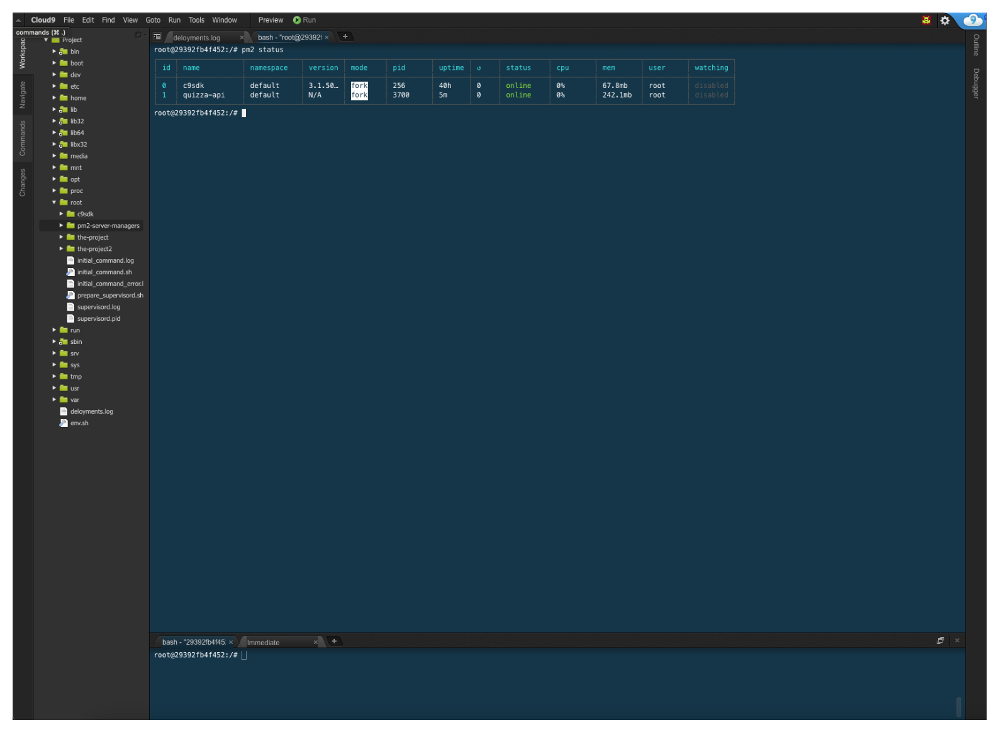

## Intro

This Docker container is a IDE / Code editor, built from [C9 SDK](https://github.com/c9/core) ([fork](https://github.com/lequanghuylc/c9sdk) with sub path + new Node.js support). With C9 IDE you can set up development environments in the cloud. It comes with [nvm](https://nvm.sh/), [pm2](https://pm2.keymetrics.io/) and [nginx](https://www.nginx.com/) that can help you publish your application pulically accessible to the world.

## Routing

nginx listens on port `8080`:

- `/ide/` → the Cloud9 IDE (basic auth `c9sdk:$C9SDK_PASSWORD`)
- `/` → the main application on `127.0.0.1:3000`. While nothing listens there (no `GIT_REPO` deployed yet), a static welcome page ([nginx/welcome](nginx/welcome/index.html)) is shown with a link to the IDE and how to deploy.

So one domain is enough: `https://domain.com/` for the app and `https://domain.com/ide/` for the IDE.

Nothing to change in deployed projects: [ensure-ide-route.sh](pm2-server-managers/ensure-ide-route.sh) adds
`include /etc/nginx/snippets/c9-ide.conf;` to every `server {}` block in `/etc/nginx/sites-enabled` — at start,
right after `setup-nginx.sh` and every 10s (in case a project regenerates its conf). So with `DOMAIN_NAME` set,
`https://$DOMAIN_NAME/ide/` works automatically. If a conf can't take the route (e.g. it defines its own `/ide`
location, `nginx -t` fails), it is left unchanged.

## Variable

- `C9SDK_PASSWORD`: password for basic auth. it would be publically accessible if this env is not defined
- `GIT_REPO`: automatic git repo deployment
- `GIT_BRANCH`: target branch, if not present, default branch will be used.
- `DOMAIN_NAME`: domain of the deployed project (used by its `setup-nginx.sh`). The IDE is available at `$DOMAIN_NAME/ide/` too.
- `INITIAL_COMMAND`: custom command that can be used for installing custom dependencies or even start your git repo your own way
- `C9_SUB_PATH`: sub path of the IDE, default `/ide`. If you change it, change `nginx/c9-ide.conf` too. Set it to an empty string to serve the IDE at the root again.

## Build args

- `NODE_VERSION` (default `24`): Node.js version of the IDE server, its file/terminal worker and the default `node` in the container.
- `C9SDK_REPO` / `C9SDK_BRANCH`: which c9sdk repository / branch to build.

## What is the best use case for this?

- Online - cross device development. it is an alternative to [code-server](https://github.com/coder/code-server). it is lighter than code-server which will be more resouce (cost) effective.
- Run any real world application without Docker (DinD is not yet supported in Railway)
- Gitlab Runner Shell executor for Gitlab CI/CD 

## Instructions to run real world application

- Run your application at some local port. for example: __python -m SimpleHTTPServer 9000__ to start a static web server at port 9000.
- Prepare your domain and add to __Service settings -> networking__. make sure the DNS record is setup.
- Add a nginx conf files to __/etc/nginx/sites-enabled__ to reserve proxy your application. make sure to use __server_name your_domain;__
- Run __nginx -t__ to test your .conf file
- Run __nginx -s reload__ to apply changes.
- Your application should be pulically accessible now.

### Auto Git Repo Deployment
- The start script checks the environment variable `GIT_REPO` (and `GIT_BRANCH`) and automatically clones and deploys the repository.
- `GIT_REPO` should be `https` url containing access token key
- The repo will be cloned to `/root/the-project`.
- The repo needs to have the following deployment structure, which is: 
    - `depoyments`: folder
    - - `deploy.sh`: suppose to install project deps and start the project
    - - `setup-cron.sh` suppose to setup cron for automatically checking new commit and pull and re-deploy
    - - `setup-nginx.sh` suppose to setup nginx reserve proxy with production domain name

